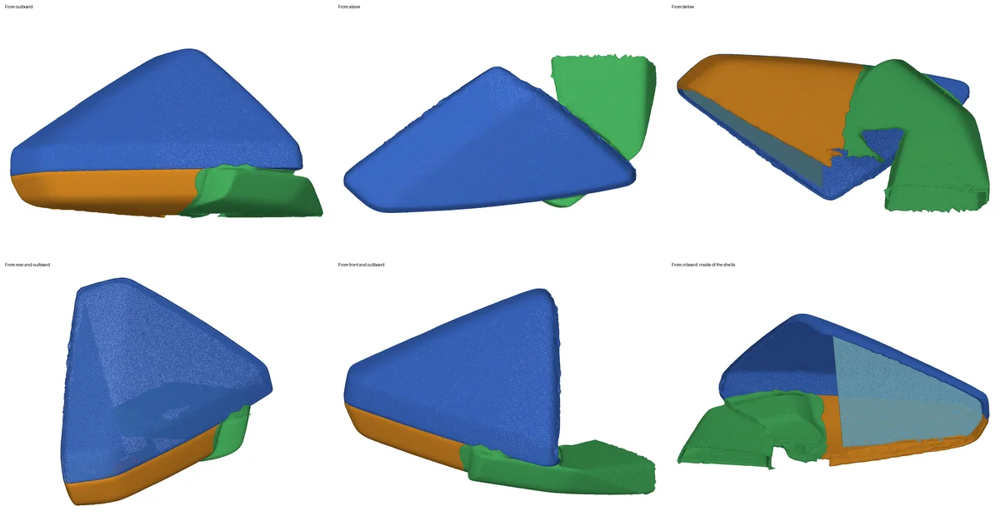
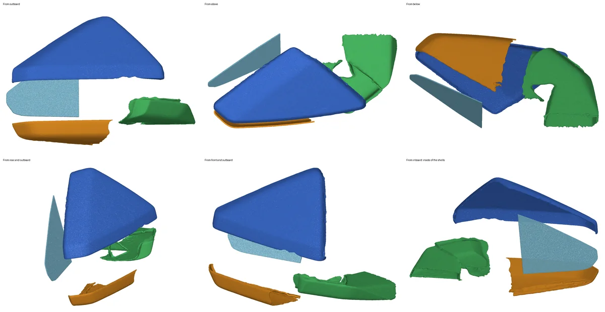
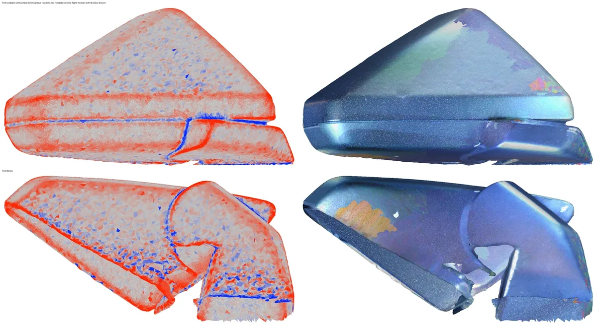

# Exterior side mirror, right hand: multi-part model

A multi-part model of the Cybertruck's right-hand exterior mirror, built from our own 3D scan of the truck. The outside shape of each part follows the scan closely. The inside is not scanned: wall thickness, clips and screw bosses are assumed or missing. Use it as reference geometry and as a starting point for printable parts, not as a finished replacement part.

Status: **v1** for the skull cap, lower housing and base (outer surfaces from a scan, not yet the inside). The glass is a placeholder.

## What the scan showed

- **The mirror was scanned folded.** Its long front face lies parallel to the door, and the glass faces the side window. So the scanner saw the top, the outboard face and the underside, but never the glass or the side that faces the window.
- **The part seams are visible in the scan.** They show up as grooves when the surface is coloured by how sharply it bends:

- **The seam between skull cap and lower housing is flat.** A plane fits it to 0.46 mm RMS over 47 seam edges. The plane is tilted 6.9° from the model's horizontal.
- **The lower housing ends at a groove around the arm.** On the underside the groove curves around a round boss on the arm. This matches the arc in the [Tesery overlay photo](../../research/exterior-side-mirrors/README.md#lower-housing).

## Files

All files are in millimetres and share one coordinate frame.

| File | What it is | Size |
|---|---|---|
| `skull-cap-rh.stl` | Upper shell: the large sloped face and the skirt down to the seam | 90,000 triangles, 4.5 MB |
| `lower-housing-rh.stl` | Lower shell: the band below the seam and the underside. This is the cover asked about in [issue #1](https://github.com/aaronse/cybertruck/issues/1). | 75,000 triangles, 3.8 MB |
| `base-rh.stl` | Fixed part: the pedestal on the door and the arm the head folds on | 60,000 triangles, 3.0 MB |
| `glass-placeholder-rh.stl` | A flat plate where the glass should be. Not scanned. | 88 triangles |
| `mirror-rh-folded-assembly.3mf` | All four parts as named, coloured objects in one file | 2.9 MB |
| `mirror-rh-folded-surfaces.step` | 17 fitted CAD surfaces, one per large face, named by part | 0.1 MB |
| `mirror-rh-folded-scan.ply` | The cleaned scan of the mirror with its colours, before any processing | 24,410 triangles, 0.5 MB |
| `metrics.json`, `surfaces.json` | Every number on this page, as measured when the model was built | |

## Parts

| Part | Size X × Y × Z (mm) | Volume (cm³) | From the scan | Assumed or missing |
|---|---|---|---|---|
| Skull cap | 334.6 × 167.5 × 146.3 | 129.4 | Outer surface, and the seam to the lower housing | Wall thickness, clips, 3 screw bosses, the rim around the glass |
| Lower housing | 221.1 × 129.4 × 55.7 | 61.3 | Outer surface, the seam to the skull cap, the groove around the arm | Wall thickness, clips, the rim around the glass |
| Base | 168.5 × 176.0 × 61.8 | 88.0 | Outer surface of the pedestal and arm, down to 3 mm above the door ledge | Everything inside the head, the foot under the ledge line, the side facing the window |
| Glass | n/a | n/a | Nothing | All of it. It is a flat 2 mm plate inside the opening's rim, set 6 mm back. The real RH glass is convex. |

The whole folded assembly measures 357.7 × 181.8 × 193.9 mm.

**Wall thickness is assumed to be 2.5 mm.** Each shell is the scanned outer surface thickened inward by that amount. Measure a real part and rebuild before printing anything that has to fit.

## Accuracy

| Check | Result |
|---|---|
| Scan resolution at the mirror | Median triangle edge 3.45 mm. This is all the detail the original export holds. |
| Parts against the scan | Of 60,000 points on the scan, 97.1% are within 0.1 mm of a part and 99.2% within 0.25 mm. The rest are seams, trimmed edges and stray scan fragments. |
| Each part's outer surface against the scan | Mean 0.03 mm for all three. 99% of points within 0.19 mm (skull cap), 0.15 mm (lower housing), 0.16 mm (base). |
| Smoothing applied before thickening | Moved the surface by 0.024 mm on average, 0.255 mm at most |
| Triangle reduction | Two-sided Hausdorff distance, sampled on vertices, edges and faces, 110,000 to 120,000 samples each way: max 0.129 mm (skull cap), 0.149 mm (lower housing), 0.093 mm (base). Means 0.002 to 0.005 mm. |
| STEP surfaces against the scan | The file was read back and each surface compared with the scan points it was fitted to: 0.19 mm RMS, 0.95 mm max over 729 points |

What these numbers do not cover:

- **The scan's own accuracy and scale are unchecked.** No caliper measurement of the mirror has been compared with the scan yet. The scanner is rated at 0.1 mm by its maker.
- **Edges and fillets are soft.** Triangles 3.45 mm across cannot hold a sharp edge or a small radius.
- **The seam around the arm is good to about ±2 mm.** It follows the groove in a mesh of 3.45 mm triangles. The flat seam between cap and lower housing is better: 0.46 mm RMS.
- **Gaps between parts are 0.4 mm by construction,** not measured.

## STEP surfaces

`mirror-rh-folded-surfaces.step` holds one B-spline surface for each large, smooth face: 6 on the skull cap, 4 on the lower housing and 7 on the base. Together they cover 68% of the scanned area. The other 32% is edges, fillets and small features.

- Each surface is a gently curved fit, not a plane. The large faces are crowned: the skull cap's main face has radii of about 1.5 m and 3.9 m.
- Each surface extends 4 mm past its face and is not trimmed. In CAD, extend and trim neighbours against each other, stitch them, then add fillets.
- [`surfaces.json`](surfaces.json) lists every surface with its fit error, size and radii.

## Coordinate frame

| Axis | Direction | Taken from |
|---|---|---|
| +X | Toward the rear of the truck | The direction of the door's top ledge beside the mirror |
| +Z | Up | The scan's own vertical, squared up to X. **Not checked against the truck's true vertical, and could be several degrees off.** |
| +Y | Outboard | Square to the other two |
| Origin | Centre of the base's foot, on the door ledge plane | |

Reference planes in this frame, from `metrics.json`:

| Plane | Point (mm) | Normal |
|---|---|---|
| Door ledge under the mirror | (0, 0, 0) | (0.000, 0.109, 0.994) |
| Side window | (92.8, −161.2, 289.1) | (0.010, 0.901, 0.435) |
| Seam between skull cap and lower housing | (201.3, 140.3, 55.8) | (0.027, −0.117, 0.993) |
| Rim of the glass opening | (219.5, 70.2, 57.9) | (0.392, −0.866, −0.309), fits the rim to only 4.0 mm RMS |

`metrics.json` also holds `scan_to_model`, the 4 × 4 matrix that maps the original scan's coordinates into this frame.

## How it was built

From `cy_right_3.obj`, the textured Creality scan of the truck's whole right side (1,000,003 triangles), which is too large for this repo. The mirror is 24,410 of those triangles. `mirror-rh-folded-scan.ply` is that part of the scan, cleaned and moved into the model's frame, so every part can be checked against it. The tooling that turns the scan into parts is not published.

## Known gaps and next steps

1. **Check the scale.** Measure 5 to 10 lengths on the real mirror with calipers and compare them with the model. The skull cap's long outboard edge is the easiest: the part is 334.6 mm long.
2. **Measure a real wall thickness** and rebuild with it.
3. **Add the inside of the lower housing:** clips and bosses, from photos and measurements of a mirror with the cover removed.
4. **Rescan at finer resolution** for edges, fillets and the rim around the glass. Scan the mirror unfolded as well, to capture the glass side.
5. **Make an unfolded assembly.** That needs the fold axis. The round boss on the arm's underside marks where it is, but I could not fit its centre well enough from this scan.
6. **Left-hand parts** are not made. Mirroring these across the XZ plane is a starting point, but the LH glass is flat and the RH glass is convex.

One observation I could not turn into a check: in the scan, the folded mirror's outer face sits 72 mm outboard of the widest crease of the doors and 11 mm inboard of the front fender flare. The owner's manual says folded mirrors add 84.6 mm per side to the width without mirrors. Whether those agree depends on where Tesla measures that width, and on this frame's unverified vertical.
