# Exterior side mirrors

Research into the Cybertruck exterior (wing) mirror. The aim is 3D printable replacement parts and mods, starting with the **lower housing cover** asked about in [issue #1](https://github.com/aaronse/cybertruck/issues/1). Tesla does not sell that cover on its own. Owners who lose it are quoted a whole mirror assembly: $310 in Nov 2024, and $730 by Apr 2026.

Researched 2026-11-17. Prices and part numbers come from dated screenshots and forum posts, so check the current [Tesla EPC](https://epc.tesla.com/en-US/landingpage) against your VIN before ordering.

Every image on this page is committed under [`img/`](img/). Third-party images are under [`img/third-party/<website>/`](img/third-party/), and [CREDITS.md](img/third-party/CREDITS.md) gives each one's source and owner.

## Findings

1. **The lower cover has no part number.** Tesla's parts catalog (EPC) section *1209 - Exterior Mirrors* lists 7 lines: the LH and RH assemblies, the LH and RH skull caps, the LH and RH glass, and the mounting bolts. The lower housing is not among them ([EPC screenshot, 2024-11-16](#s4)). Owners who asked their service centres report the same ([s5](#s5), [s7](#s7)).
2. **It is a separate plastic shell that clips on.** Owner photos show a split line between the upper skull cap and the lower housing ([s7](#s7)). One owner who took a mirror apart said the lower part "is really just the same thing as the upper housing" ([s5](#s5)). Another described it as "just one plastic piece that clips in" ([s7](#s7)). How it attaches has not been documented: the number and position of clips, whether there are screws, and whether it can come off without taking the mirror head apart.
3. **There is no trusted public 3D model of the mirror head or the lower cover.** I searched Printables, MakerWorld and Sketchfab and checked the paid marketplaces. Every full-vehicle model is a toy, a game or render asset, or the 2019 prototype, which has no side mirrors. The only full-scale mirror-related model is a door-side mirror-delete cover, which is [cached locally](#local-cache-gitignored). See [3D models](#3d-models).
4. **Our scan gives the outside shape and the part seams, but not clips.** The original scan resolves the mirror at 3.45 mm per triangle and shows the seams between skull cap, lower housing and base. A [multi-part model](../../models/exterior-side-mirror/) built from it follows the scan to within 0.1 mm over 97% of the surface. Nothing inside the shells was scanned. See [Our scan](#our-scan).
5. **The geometry has to come from a mirror in hand.** Either make a fine scan of an intact underside, or measure the clip slots in the requester's mirror, where the cover is already missing. See [Plan](#plan-printable-lower-cover).

## Parts and prices

From Tesla's EPC, *Cybertruck US › 12 - Exterior Fittings › 1209 - Exterior Mirrors*, as screenshotted by an owner on 2024-11-16 ([s4](#s4)):

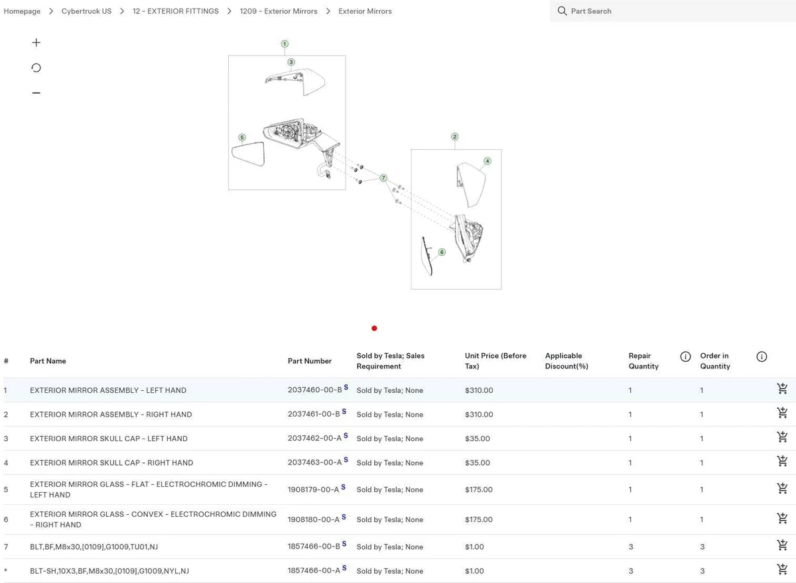

| # | Part name (EPC) | Part number | Price (Nov 2024) |
|---|---|---|---|
| 1 | Exterior mirror assembly - left hand | 2037460-00-B | $310.00 |
| 2 | Exterior mirror assembly - right hand | 2037461-00-B | $310.00 |
| 3 | Exterior mirror skull cap - left hand | 2037462-00-A | $35.00 |
| 4 | Exterior mirror skull cap - right hand | 2037463-00-A | $35.00 |
| 5 | Exterior mirror glass - flat - electrochromic dimming - left hand | 1908179-00-A | $175.00 |
| 6 | Exterior mirror glass - **convex** - electrochromic dimming - right hand | 1908180-00-A | $175.00 |
| 7 | BLT,BF,M8x30,[0109],G1009,TU01,NJ (×3) | 1857466-00-B | $1.00 each |
| * | BLT-SH,10X3,BF,M8x30,[0109],G1009,NYL,NJ (alternate) | 1857466-00-A | $1.00 each |

Other numbers and prices reported over time:

| Date | Item | Number / price | Source |
|---|---|---|---|
| 2024-03-17 | Skull cap, earlier part numbers | LH 1761516-00-A, RH 1761517-00-A | [s5](#s5) |
| 2024-11-15 | RH assembly, fitted by Tesla | $365 part + $159.75 labour (0.71 h) = $524.75 | [s6](#s6) |
| 2024-11-16 | Collision centre quote, RH | $850 | [s6](#s6) |
| 2024-12-07 | Assembly, bought for self-install | $334 | [s6](#s6) |
| 2025-04-23 | Skull cap, ordered through the app | $40 | [s5](#s5) |
| 2025-04-24 | RH assembly / RH skull cap | 2037461-00-B $310 / 1761517-00-A $70 | [s5](#s5) |
| 2026-03-25 | Assembly in the parts catalog | 1761515-99-C (variant not explained) | [s5](#s5) |
| 2026-04-17 | Whole mirror unit / skull cap | **$730** / $35 | [s7](#s7) |
| 2026-04-17 | Used LH assembly, private sale | $535 | [s7](#s7) |

Reseller listings also give 1761514-00-B (LH) and 1761515-B0-B (RH) as earlier assembly numbers. One eBay listing labels 2037460-00-B as "left mirror glass", but the EPC lists it as the LH assembly. I have not verified the reseller numbers.

**Change in 2026:** in September 2026 Tesla switched the mirror caps from painted plastic to the grained plastic used on the fenders. Cybertruck lead engineer Wes Morrill said the paint "was too easy to scratch" ([s9](#s9)). Whether the lower housing changed too is not reported.

## Anatomy

Each EPC diagram shows three separate pieces per side ([s4](#s4)):

- **Skull cap (3, 4)**: the large triangular upper and outer shell. It is sold separately.
- **Glass (5, 6)**: an electrochromic glass that clips in. LH is flat, RH is **convex**, and each has 3 connectors.
- **Assembly body (1, 2)**: the arm, fold actuator, glass carrier, harness and **lower housing**, sold together. Three M8×30 bolts fix it to the door.

| EPC exploded view, LH: skull cap (3), glass (5), body with arm and bolts | Assembly off the truck |
|---|---|
| 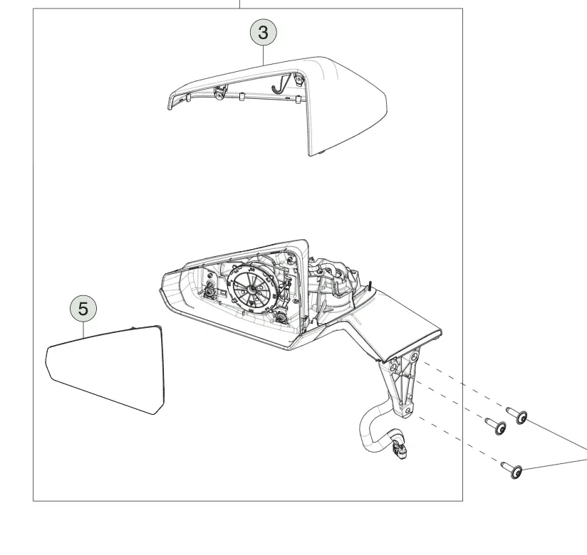 | 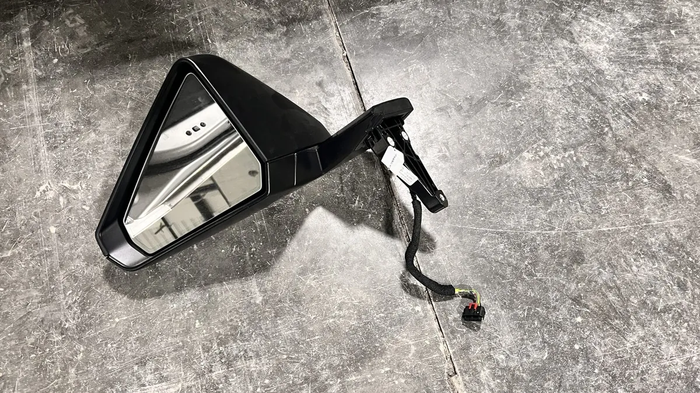 |

Service manual photos ([s1](#s1)):

| From below, folded: T10 screw at the inboard edge | Cap lifting off: the lower housing stays on the body |
|---|---|
| 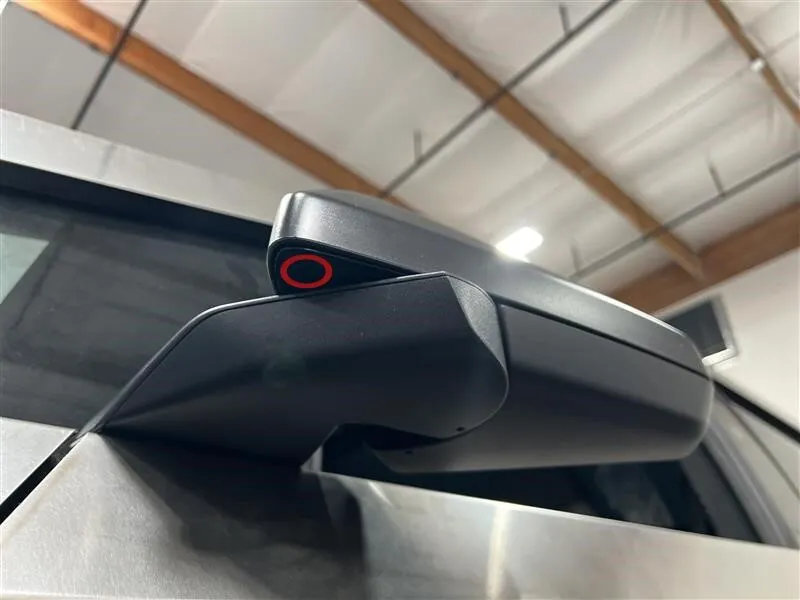 | 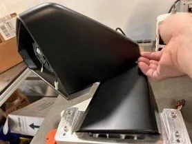 |

| Glass removed: 2 skull cap screws behind it | Skull cap on its own |
|---|---|
| 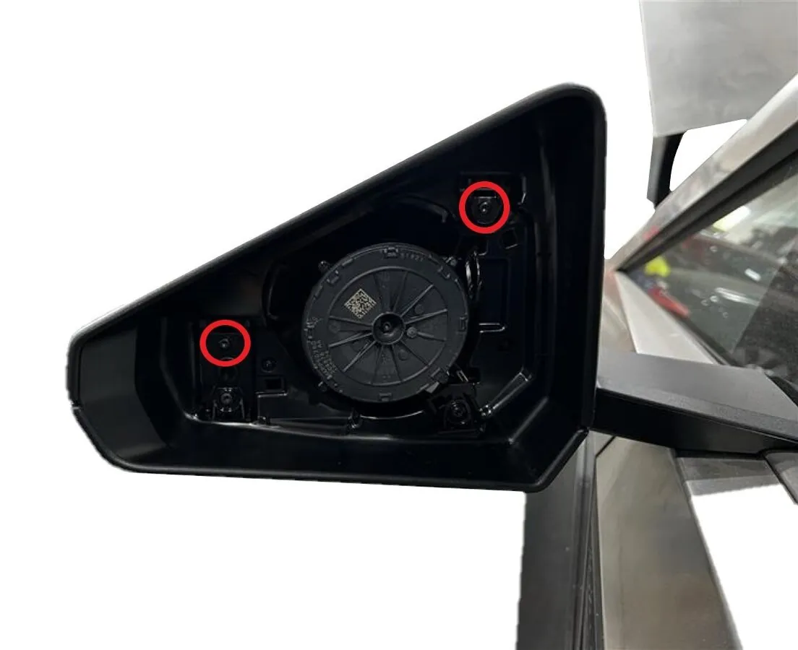 | 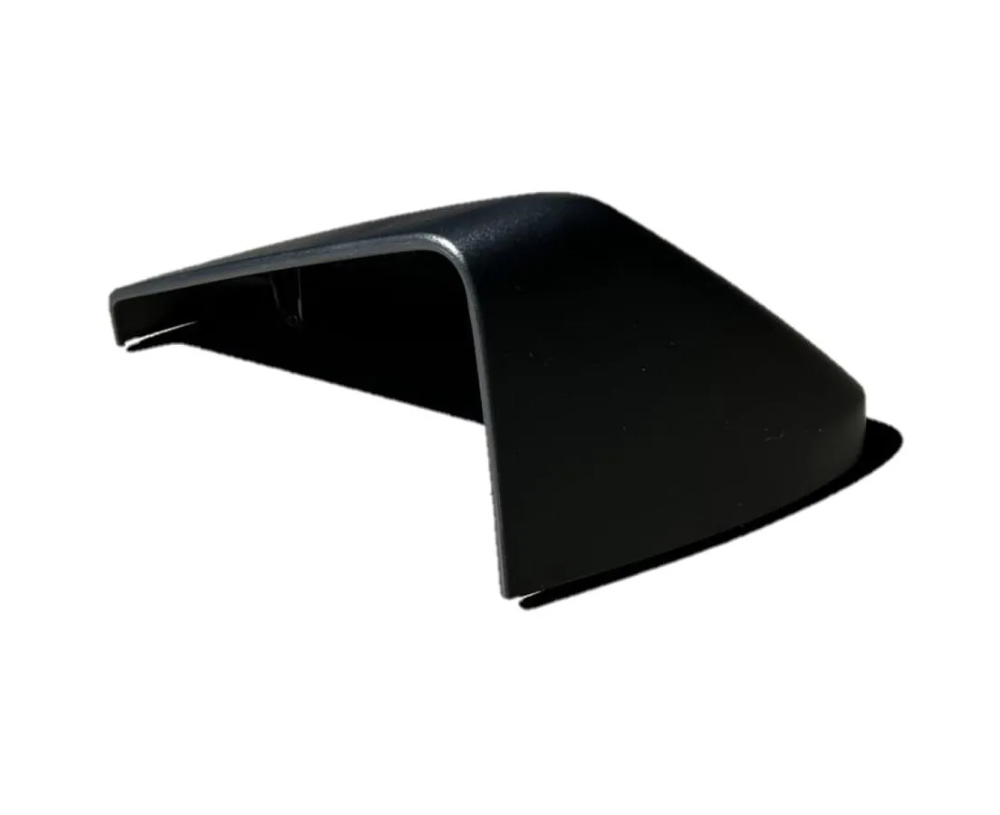 |

### Lower housing

No Tesla source shows the lower housing on its own. Owner photos from thread 56966 show it from outside ([s7](#s7)):

| Split line between the skull cap and the cracked lower housing | Lower housing cracked at a corner |
|---|---|
| 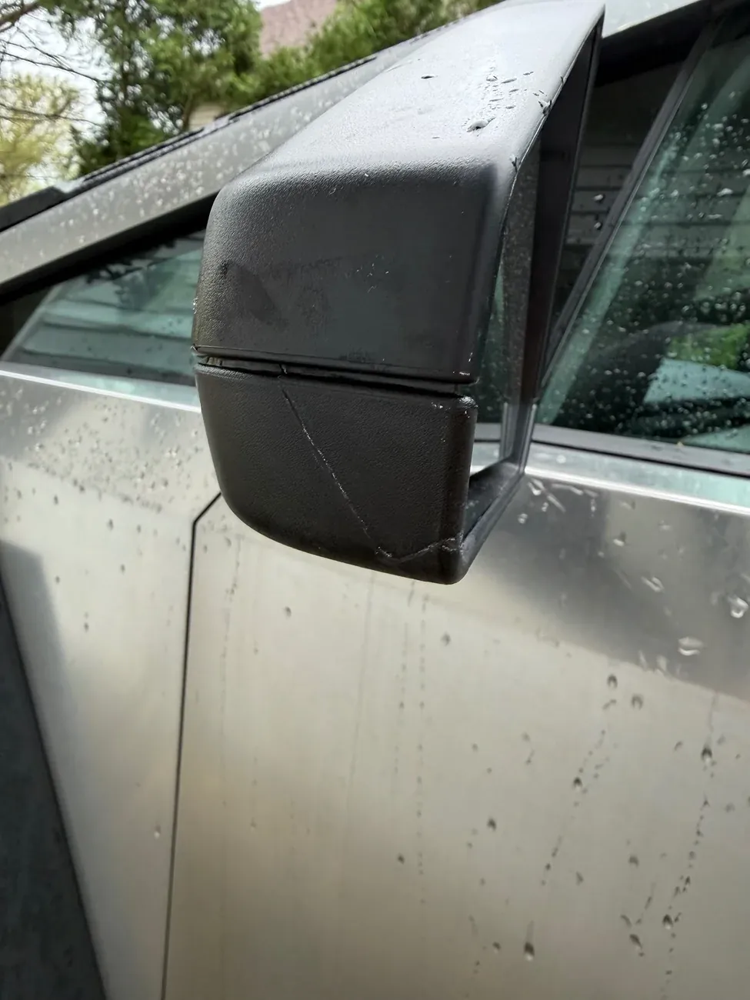 | 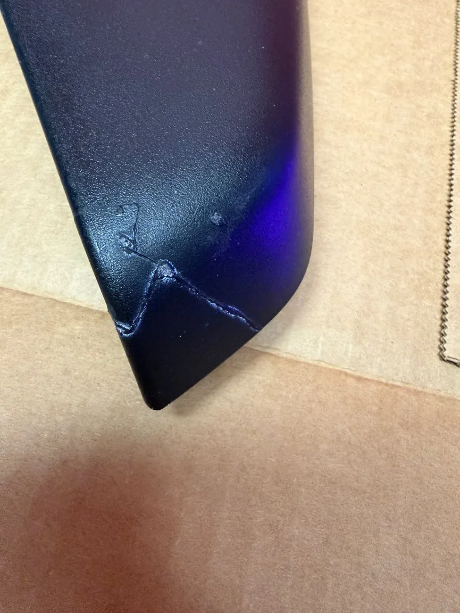 |

Tesery's carbon overlay is moulded to fit over this housing, so its product photos are the clearest view of the housing's outline ([s8](#s8)):

| Overlay outline | Inside of the overlay | Fitted on a truck |
|---|---|---|
| 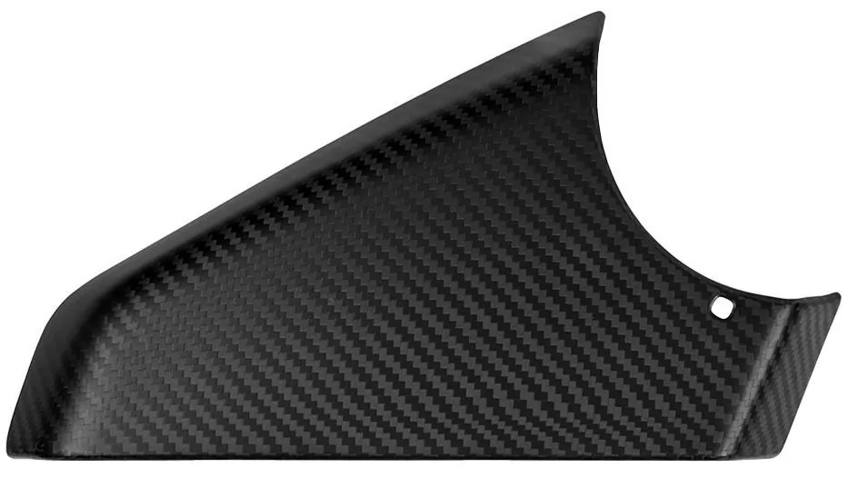 | 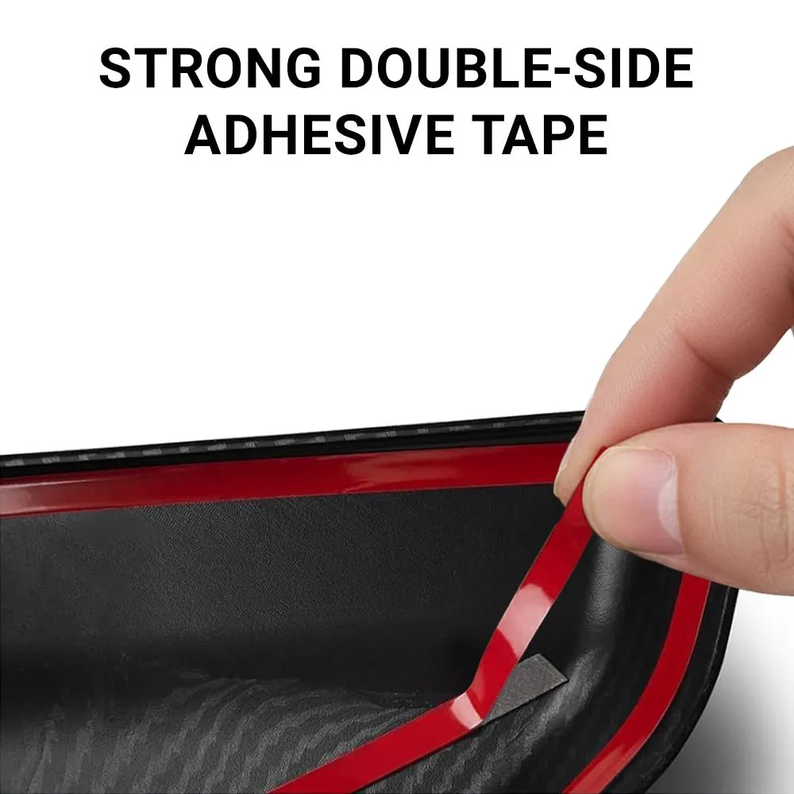 | 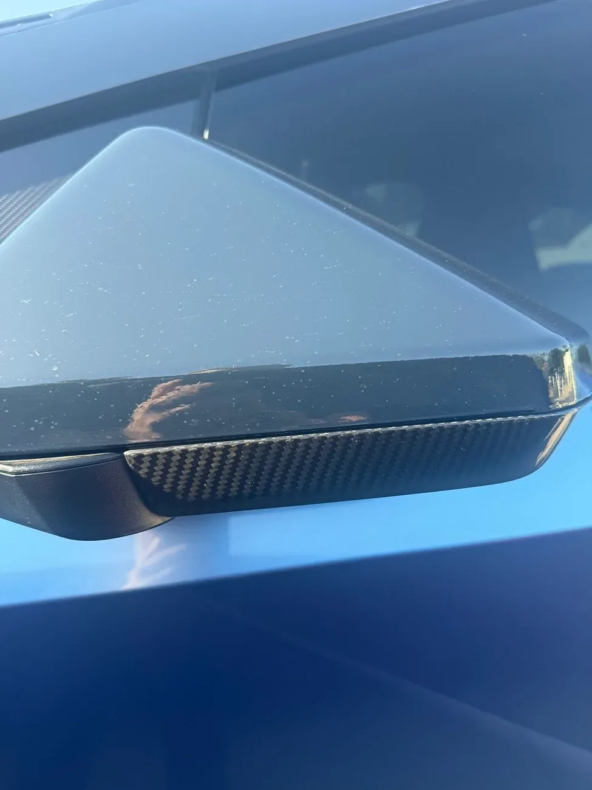 |

What the overlay photos show:

- **The outline** has a long sloped top edge along the split line, a deep arc where the arm meets the head, and a returned lip at the inboard end. It is the visible outline of the OEM housing, slightly enlarged by the overlay's wall thickness. With one known dimension measured on a real mirror, it could be scaled into a 2D template.
- **A small rectangular hole near the inboard end of the arc.** It probably clears the T10 skull cap screw that the service manual places "under the inboard edge". That is an inference: the two positions match in the photos, but nothing has been measured.
- **The inside of the overlay** has double-sided tape around the edge and a foam pad. So the overlay sticks onto the intact OEM shell and cannot stand in for a missing one. It gives no information about the OEM clips.

## Service procedures

The Tesla service manual documents only LH procedures, all under *12 - Exterior Fittings › 1209 - Exterior Mirrors* ([s1](#s1)). None of them covers the lower housing.

| Procedure | Correction code | Fasteners | Tool | Torque | Notes |
|---|---|---|---|---|---|
| [Exterior Mirror Assembly - Electromechanical - LH](https://service.tesla.com/docs/Cybertruck/ServiceManual/en-us/GUID-E5FC5791-2CCB-49E2-A210-2300460B0063.html) | 1209034051 | 3 bolts, PN 1857466-00-B, single-use | Torx T40 | 18 Nm (13.3 lb-ft) | 1 connector behind the door panel plug. 3 belt-seal retaining plugs. Fit new bolts (revision 2024-08-01). |
| [Skull Cap - Exterior Mirror - LH](https://service.tesla.com/docs/Cybertruck/ServiceManual/en-us/GUID-CA20A92E-6874-4C0F-9EBA-D67C2CDE7BFC.html) | 1209034031 | 3 screws | Torx T10 bit + Torx T15 socket | 0.5 Nm (4 lb-in) | Unfold the mirror, remove the glass, fold the mirror, remove the screws. Work a trim tool between cap and bezel, then lift from the outboard end. "The T10 screw is located under the inboard edge of the mirror assembly." |
| [Exterior Mirror Glass - Flat - Electrochromic Dimming - LH](https://service.tesla.com/docs/Cybertruck/ServiceManual/en-us/GUID-F868AFA5-83DA-4585-AF37-34C5F71D405C.html) | 1209034071 | clips | none | none | Push the glass fully outboard, then up, and pull from the inboard lower corner. 3 connectors. It clicks audibly when seated. |

Owners add that the assembly swap is "3 bolts and a plug", plus a clip that holds a trim cover to the door frame ([s5](#s5)).

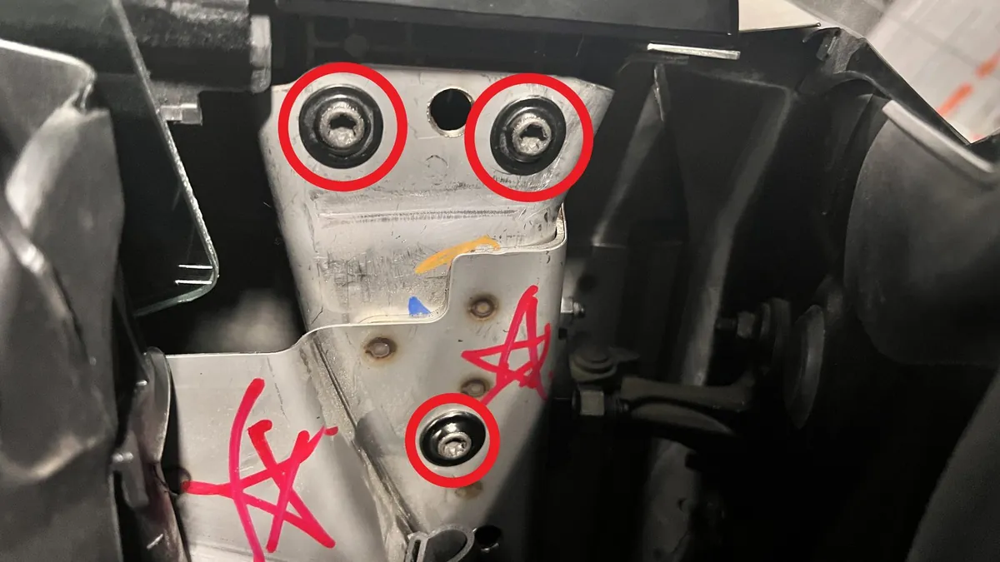

## Dimensions

| Measure | Value | Source |
|---|---|---|
| Overall width, mirrors unfolded | 2413.3 mm (95.01 in) | Owner's manual ([s2](#s2)) |
| Overall width, mirrors folded | 2200.7 mm (86.64 in) | [s2](#s2) |
| Width without mirrors | 2031.6 mm (79.98 in) | [s2](#s2) |
| **Mirror reach past the body, unfolded** | **190.9 mm per side** | Derived: (2413.3 − 2031.6) / 2 |
| Mirror reach past the body, folded | 84.6 mm per side | Derived: (2200.7 − 2031.6) / 2 |
| Door-skin opening the mirror base fills | about 89 × 44 mm | Measured from TickTock's mirror-delete cover STL ([s10](#s10)), not OEM |
| Skull cap screw torque | 0.5 Nm | [s1](#s1) |
| Lower cover wall thickness, clip pitch, clip size | **unknown** | Measure at the requester's broken edge, or from a removed shell |

## 3D models

| Source | What it is | Licence | Verdict |
|---|---|---|---|
| [Printables 934550, *Cybertruck Mirror Delete Cover*](https://www.printables.com/model/934550-cybertruck-mirror-delete-cover) by TickTock | Full-scale cover and trim for the door hole left when the mirror is removed. 154 downloads, also ordered in 316 stainless. | CC BY | **Cached.** The only trusted full-scale mirror-interface geometry found, but it covers the door side, not the mirror head. |
| [Printables 943201, *Mirror Connector Cover*](https://www.printables.com/model/943201-cybertruck-mirror-connector-cover) by TickTock | TPU cap for the exposed mirror connector pins | CC BY | Not cached: no head geometry |
| [Printables 575806, *Tesla Cybertruck (high detail)*](https://www.printables.com/model/575806-tesla-cybertruck-high-detail) | Hand-modelled at real scale | CC BY-NC | Rejected. I rendered it: it has **no side mirrors**, and its proportions are prototype-like (5910 mm long). |
| Sketchfab, most-liked "Tesla Cybertruck" models | Render meshes, published 2019-11 | various | Rejected: 2019 prototype with no mirrors. Downloads need a login. |
| MakerWorld and Printables searches for "cybertruck mirror", "side mirror", "mirror cover" and "mirror cap" | Interior rear-view mirror caps, delete covers, toys | n/a | No mirror head and no lower cover exists |
| CGTrader, RenderHub, 3DCadBrowser (paid) | Render or CAD models that sellers describe as "real-world scale" | paid | Not bought. None says it is scan-derived, and the mirror accuracy is unverified. |
| Thingiverse, Cults3D, GrabCAD | n/a | n/a | Not searched: these sites block scripted search |

**Aftermarket parts as shape references:** carbon-fibre lower-mirror overlays from Tesery and others are moulded to the OEM lower housing and held on with tape. See [Lower housing](#lower-housing). Abstract Ocean sells an XPEL Armor kit cut to the same panel ([s7](#s7)).

## Our scan

**Update:** the full scan this file was cut from (`cy_right_3.obj`, the truck's whole right side) has since been used to build a [multi-part model of the mirror](../../models/exterior-side-mirror/). It has about twice the linear detail of the rough STL below, and colour. It showed that the mirror was scanned **folded**, so the open side is the glass side, and the underside was captured. The rest of this section describes the older rough export.

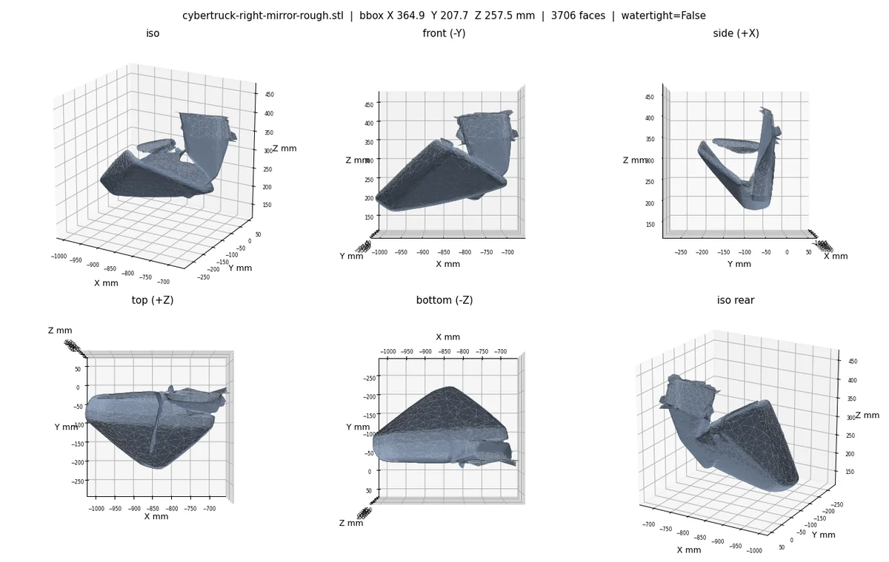

| Property | Value |
|---|---|
| File | [`scan-3d/cybertruck-right-mirror-rough.stl`](../../scan-3d/cybertruck-right-mirror-rough.stl) (binary, Meshmixer export) |
| Faces / vertices | 3,706 / 2,130 |
| Bounding box (scan frame) | 364.9 × 207.7 × 257.5 mm, including part of the arm |
| Edge length | median 7.1 mm, 90th percentile 17.1 mm |
| Watertight | No. There are 2 open boundaries: a ragged 322 × 203 mm opening (not planar, RMS 29 mm) and a 162 × 97 mm opening that is roughly planar (RMS 6 mm), probably the arm cut. |
| Frame | Arbitrary. Not aligned to vehicle axes. |

It is good for the envelope and for checking proportions. It is too coarse for clips, tabs or the split line. A closer test showed that the large faces are gently curved, and that the underlying scan data is good to about 0.3 mm.

The whole assembly as a multi-part model is in [models/exterior-side-mirror](../../models/exterior-side-mirror/).

## Plan: printable lower cover

1. **Get the mating geometry from the requester's mirror.** Their RH mirror has the cover missing, so the clip slots and bosses it engaged are exposed. Ask for square-on photos with a ruler in frame, caliper measurements of each slot (position, width, depth), and the wall thickness at any remaining broken edge. One measured length, such as the straight bottom edge, also lets us scale the [Tesery outline](#lower-housing) into a 2D template.
2. **Rescan an intact underside at about 1 mm.** Use the Creality scanner from the [main README](../../README.md#dimensions) with marker dots. Black textured plastic scans poorly, so dust it with a vanishing scanning spray. Scan with the mirror folded so the underside faces out.
3. **Optionally remove the skull cap from an intact mirror.** It takes 0.5 Nm screws and is documented ([s1](#s1)). Photograph how the lower housing meets the body. Do not pry the lower housing off until we know how it attaches.
4. **Model it in Fusion.** Fit surfaces to the scan, shell inward to the measured wall thickness, and add clips that match step 1. Print a fit-test coupon of the clip row before the full part.
5. **Print.** Use ASA for UV and heat resistance, which needs an enclosed printer. TickTock found ASA too brittle for the clip-on trim and used PETG for clips ([s10](#s10)). Test both, or print an ASA shell with PETG clips.
6. **Publish** to `mods/<name>/` with STL and 3MF files, as with [`mods/wheel-center-cap`](../../mods/wheel-center-cap/).

## Issue #1: questions answered

| Question | Answer |
|---|---|
| Is there a scan or CAD of the underside? | Only our rough scan, which gives the envelope but no clip detail. No public model exists. |
| Mounting clip details? | Not documented anywhere I could find. Getting them is step 1 of the plan. |
| Can the left side be mirrored for the right? | **Probably for the outer shell**, because the LH and RH parts are mirror-image pairs with separate part numbers. But the RH glass is convex and the LH glass is flat, so the bezel and glass recess may differ. Test-fit before trusting a mirrored LH model. This is inferred, not measured. |
| Can I buy just the lower cover? | No. The EPC lists none. The cheapest OEM route is the RH assembly 2037461-00-B, $310 in Nov 2024 and quoted $730 in Apr 2026. |

## Open questions

- How does the lower housing attach: how many clips, where, and are there screws?
- Did the lower housing change part number or material along with the September 2026 cap change?
- What do the -99-C and -B0-B suffixes mean (for example, remanufactured or service variants)?
- Are the RH and LH lower housings exact mirror images?

## Local cache (gitignored)

Full-size originals and third-party models live in `research/exterior-side-mirrors/.cache/`, which only exists in a clone where someone ran this research. The root [`.gitignore`](../../.gitignore) excludes every `.cache/` folder. The page never links into `.cache/`. Images it shows are committed copies in `img/`.

| Path | Source | Licence |
|---|---|---|
| `printables-934550-mirror-delete-cover/ctmdc_{ds,ps}.stl` (cover, 89 × 44 × 6.2 mm) and `ctmdt_{ds,ps}.stl` (trim, 92 × 8.8 × 31 mm) | [Printables 934550](https://www.printables.com/model/934550-cybertruck-mirror-delete-cover), v1 files | CC BY, TickTock |
| `evidence/tesla-service-manual/*.jpg` (26 images) | The three service manual pages in [Service procedures](#service-procedures) | © Tesla |
| `evidence/forum/epc-1209-exterior-mirrors-2024-11-16.png` | EPC screenshot, [s4](#s4) | © Tesla, posted by an owner |
| `evidence/forum/epc-mirror-exploded-2024-03-17.png` | EPC diagram, [s5](#s5) | © Tesla, posted by an owner |
| `evidence/forum/56966-*.webp` (6 photos) | Thread 56966, [s7](#s7) | Owner photos |
| `evidence/tesery.com/*.jpg` (2 product photos) | [s8](#s8) | © Tesery |

## Sources

All accessed 2026-11-17.

1. Tesla Cybertruck Service Manual, [1209 - Exterior Mirrors](https://service.tesla.com/docs/Cybertruck/ServiceManual/en-us/GUID-D3D5C561-71B0-4732-AC3B-44996E705108.html), and the three linked procedures.
2. Tesla Cybertruck Owner's Manual, [Dimensions, Weights, and Cargo Capacity](https://www.tesla.com/ownersmanual/cybertruck/en_us/GUID-12A976DD-EB60-431B-AFF1-5A37E95006DB.html).
3. Tesla EPC, [public landing page](https://epc.tesla.com/en-US/landingpage). It refuses scripted access, so prices here come from owners' screenshots.
4. Cybertruck Owners Club, *Cybertruck side mirror vs garage door*, [AO-Pete's EPC screenshot, 2024-11-16](https://www.cybertruckownersclub.com/forum/threads/cybertruck-side-mirror-vs-garage-door-how-much-to-fix-side-mirror.30400/post-538654).
5. Cybertruck Owners Club, [*Broke my plastic side mirror housing, where to buy replacement part*](https://www.cybertruckownersclub.com/forum/threads/broke-my-plastic-side-mirror-housing-where-to-buy-replacement-part.13501/), posts [265034](https://www.cybertruckownersclub.com/forum/threads/broke-my-plastic-side-mirror-housing-where-to-buy-replacement-part.13501/post-265034) (skull cap part numbers), [393928](https://www.cybertruckownersclub.com/forum/threads/broke-my-plastic-side-mirror-housing-where-to-buy-replacement-part.13501/post-393928) (lower housing is part of the assembly), [30560064](https://www.cybertruckownersclub.com/forum/threads/broke-my-plastic-side-mirror-housing-where-to-buy-replacement-part.13501/post-30560064) and [30560067](https://www.cybertruckownersclub.com/forum/threads/broke-my-plastic-side-mirror-housing-where-to-buy-replacement-part.13501/post-30560067) (prices and part numbers), [30789624](https://www.cybertruckownersclub.com/forum/threads/broke-my-plastic-side-mirror-housing-where-to-buy-replacement-part.13501/post-30789624) (3 bolts and a plug).
6. Cybertruck Owners Club, [*Cybertruck side mirror vs garage door, how much to fix*](https://www.cybertruckownersclub.com/forum/threads/cybertruck-side-mirror-vs-garage-door-how-much-to-fix-side-mirror.30400/), posts 538329, 538488 and 559070.
7. Cybertruck Owners Club, [*Help finding part to replace broken side mirror housing*](https://www.cybertruckownersclub.com/forum/threads/help-finding-part-to-replace-broken-side-mirror-housing.56966/), 2026-04-17. It includes photos of the split line and the cracked lower housing.
8. Tesery, [Cybertruck side mirror bottom cover, dry carbon fibre](https://www.tesery.com/products/cybertruck-bottom-side-view-mirror-overlays-carbon-fiber-trim). The page was rate-limited during research, so its about $160 price comes from a search snippet.
9. TeslaNorth, [Tesla swaps Cybertruck's painted mirror caps for tougher textured plastic](https://teslanorth.com/2026/09/20/tesla-cybertruck-mirror-caps-textured-plastic/), 2026-09-20.
10. TickTock, [Cybertruck Mirror Delete Cover](https://www.printables.com/model/934550-cybertruck-mirror-delete-cover), and the [forum thread](https://www.cybertruckownersclub.com/forum/threads/3d-print-mirror-delete-covers-now-printed-in-stainless-steel.20057/).
11. Torque News, [How to remove side mirrors on your Tesla Cybertruck](https://torquenews.com/14335/how-remove-side-mirrors-your-tesla-cybertruck-2-minute-guide), 2023-12-17.
